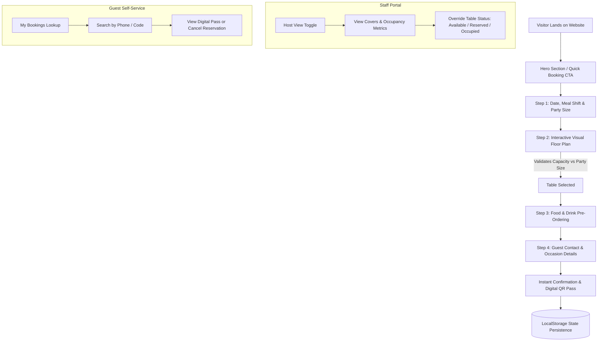
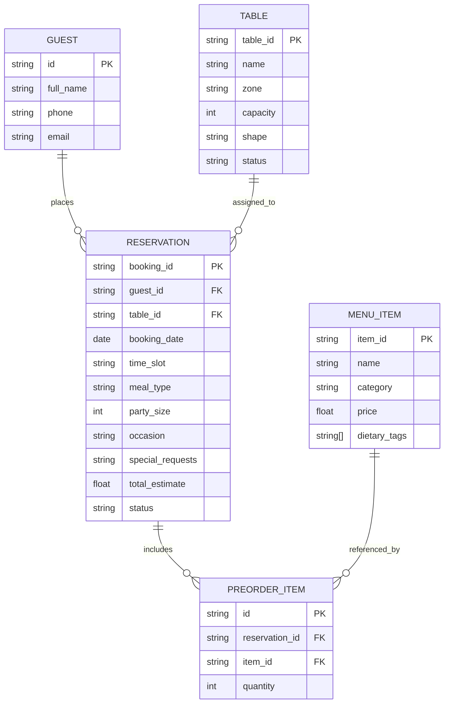

# 🍽️ Zaika India | Authentic Royal Table Reservation

> **Academic Project** | Front-End Engineering & Web Development  
> **Target Audience:** 3rd Year B.Tech / B.E. / BCA / MCA / B.Sc Computer Science Evaluation, Lab Vivas & Portfolio

---

## 📌 1. Project Overview & Problem Statement

### The Problem
Traditional restaurant reservations via phone calls or basic forms suffer from several pain points:
1. **Blind Seating:** Diners cannot pick their preferred table, zone, or seating atmosphere (e.g. romantic booths vs. outdoor terrace).
2. **Double-Booking & Capacity Mismatch:** Guests frequently book tables that cannot comfortably accommodate their party size.
3. **Turnover Bottlenecks:** Guests wait 20–30 minutes upon arrival just to place food and drink orders.
4. **Lack of Self-Service:** Customers cannot look up, review, or cancel their bookings without calling staff.

### The Solution
**L'Aura Bistro Table Reservation System** is a responsive, interactive web application featuring:
* **Interactive 2D Visual Floor Plan:** Diners see realistic spatial table positions, shapes (round, square, booth), and live availability.
* **4-Step Booking Wizard:** Guided flow with real-time party size and table capacity validation.
* **Menu Pre-Ordering Cart:** Welcome drinks and starters pre-ordered to minimize table turnover times.
* **Digital Booking Pass with QR Code:** Instant printable ticket for fast-track host check-in.
* **Self-Service Reservation Management:** Search by phone number or booking reference to view or cancel.
* **Host / Maitre D' Command Portal:** Switch between Customer View and Staff View to manage live table statuses and cover counts.

---

## 🏗️ 2. System Architecture & Flow



---

## 🗄️ 3. Entity-Relationship (ER) Data Model

Even though this version uses client-side state and `localStorage`, the data structure is built to map 1:1 to a relational SQL (PostgreSQL/MySQL) or NoSQL (MongoDB) database:



---

## 💻 4. Tech Stack & Engineering Highlights

* **Markup & Structure:** HTML5 (Semantic tags, accessible form controls, modals)
* **Styling & Design:** Tailwind CSS (Utility classes, responsive grid, glassmorphism) + Custom CSS (`styles.css` with print styles and SVG styling)
* **Icons & Typography:** Lucide Icons CDN, Google Fonts (*Cinzel* luxury serif + *Plus Jakarta Sans*)
* **Client-side State Management:** Pure Vanilla JavaScript (ES6+ modular IIFE pattern, reactive DOM updates, event delegation)
* **Persistence:** Web Storage API (`localStorage`) for saving bookings and table status across browser refreshes
* **Zero-Build Architecture:** No `npm install`, Webpack, or Babel required to run—opens directly in any modern browser.

---

## 🎓 5. Viva / Presentation Preparation Guide

### Top Viva Questions Evaluators Love to Ask

#### Q1: "How do you prevent a user from selecting a table smaller than their party size?"
> **Answer:** In `app.js`, when a user selects a table on the floor plan or tries to advance from Step 2 to Step 3 (`canProceedToStep`), the system runs a capacity check: `state.booking.partySize <= state.booking.selectedTable.capacity`. If violated, it alerts the user with a warning toast and prevents step transition.

#### Q2: "How does the interactive floor plan render table positions without an external canvas library?"
> **Answer:** We use CSS relative positioning on the `.floor-plan-canvas` container and calculate percentages (`x%`, `y%`) on each `.table-node` using `transform: translate(-50%, -50%)`. This ensures responsiveness across desktop and tablet screen sizes.

#### Q3: "What happens if two people try to book the same table at the same time? (Race Condition)"
> **Answer:** In the current front-end prototype, we simulate reservation locking via `localStorage` and status tags (`available`, `reserved`, `occupied`). In a production backend setup (e.g. Node.js + PostgreSQL), we would use database transactions with `SELECT ... FOR UPDATE` or optimistic locking with timestamp versioning to prevent simultaneous double-bookings.

#### Q4: "Why did you separate `data.js` from `app.js`?"
> **Answer:** Separation of concerns. `data.js` acts as the mock database / API response layer (tables, menu items, time slots), while `app.js` is the controller and UI presentation engine. When connecting to a real REST or GraphQL API, we only replace the static objects in `data.js` with `fetch()` calls.

---

## 💼 6. How to Write This on Your Resume

Add this bullet section under **Projects** on your resume:

```markdown
• Restaurant Table Reservation & Floor Management System | HTML5, Tailwind CSS, JavaScript (ES6+), LocalStorage
  - Designed an interactive 2D floor plan allowing diners to choose specific tables based on capacity, view, and ambiance.
  - Developed a 4-step booking wizard with dynamic time slot availability, food pre-ordering, and real-time total estimation.
  - Implemented client-side state management and LocalStorage persistence with self-service cancellation and digital QR pass generation.
  - Built a dual-role Host Portal allowing restaurant staff to track expected guest covers and override table turnover statuses.
```

---

## 🚀 7. Roadmap to Turn This into a Full-Stack Final Year Project

If you want to extend this project for your 7th/8th semester or Capstone project:
1. **Backend:** Build a Node.js + Express.js or Python FastAPI server with RESTful endpoints (`/api/reservations`, `/api/tables`, `/api/menu`).
2. **Database:** Connect PostgreSQL or MongoDB to store table logs and customer order histories.
3. **Authentication:** Add JWT-based login for Staff vs. Customers (Google OAuth / OTP via Twilio).
4. **Notifications:** Send real SMS confirmations via Twilio API and Email passes with Nodemailer / SendGrid.
5. **Payment Gateway:** Integrate Razorpay / Stripe for advance booking deposits.

